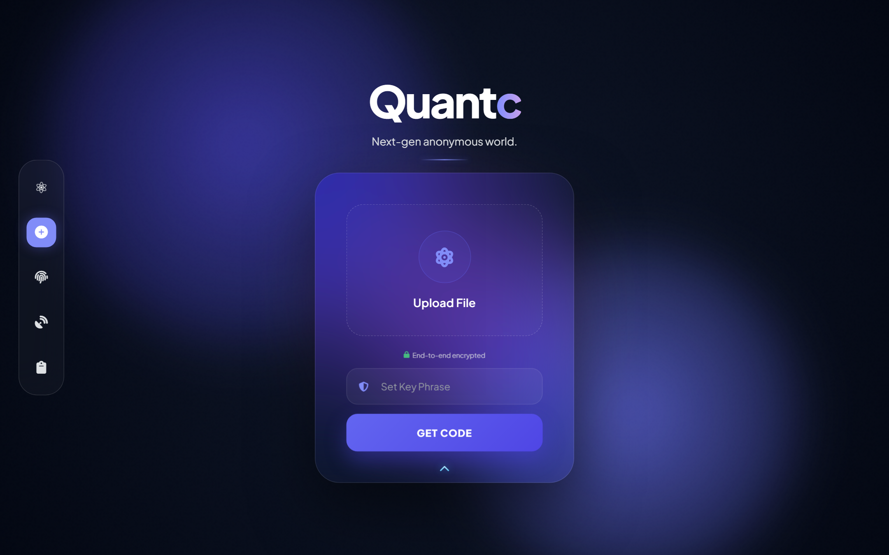
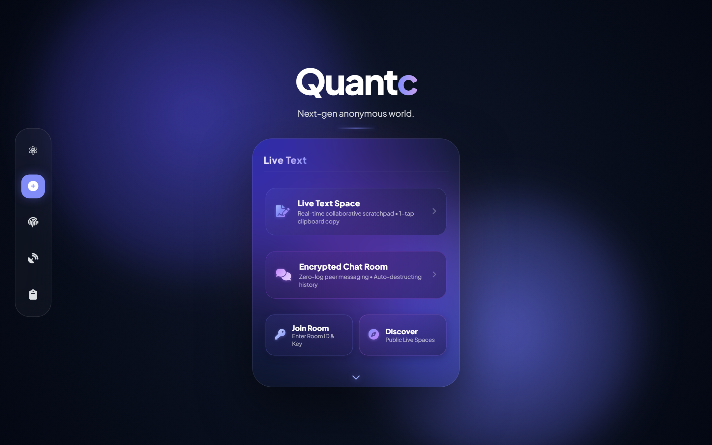
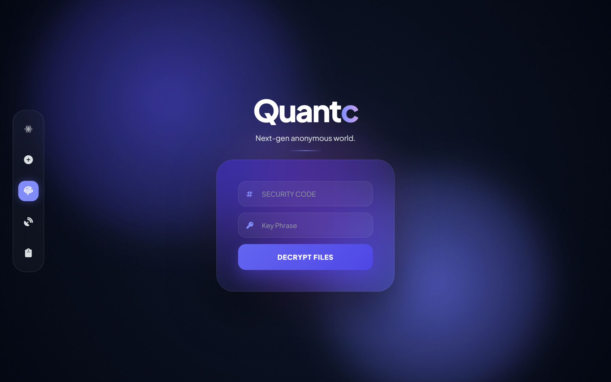
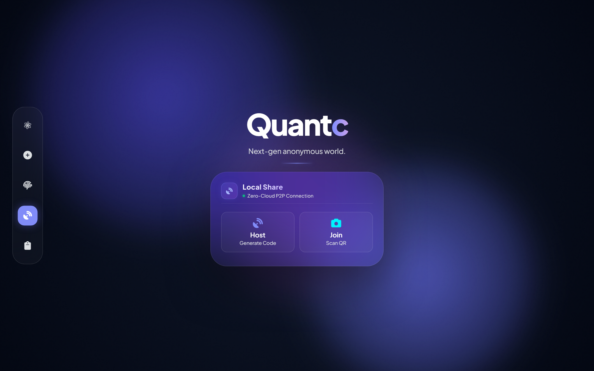
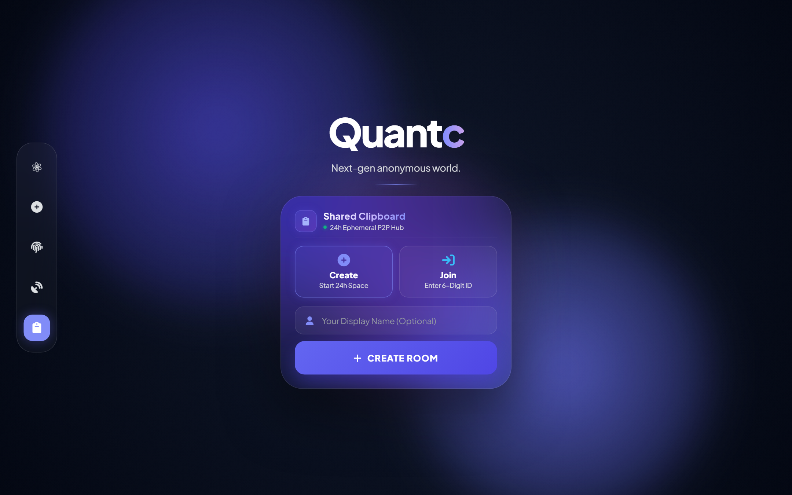

<div align="center">


<br/>

[](https://quantc-arya.vercel.app)

<br/>

<p>
  
  &nbsp;
  
  &nbsp;
  
  &nbsp;
  
</p>

<p>
  
  &nbsp;
  
  &nbsp;
  
  &nbsp;
  
</p>

<br/>

<a href="https://quantc-arya.vercel.app">
  
</a>

<br/><br/>

> **Notice:** QuantC is a free-to-use, proprietary file-sharing and collaboration product. This repository provides public product information, user guides, and documentation. The application's private source code and self-hosting instructions are not distributed here.

<br/>


<p>
  <a href="#-what-is-quantc"><kbd>&nbsp;⚡&nbsp;About QuantC&nbsp;</kbd></a>&nbsp;
  <a href="#-the-four-core-features"><kbd>&nbsp;🛸&nbsp;Key Features&nbsp;</kbd></a>&nbsp;
  <a href="#-visual-interface-tour"><kbd>&nbsp;📸&nbsp;Screenshots&nbsp;</kbd></a>&nbsp;
  <a href="#-step-by-step-user-guide"><kbd>&nbsp;📖&nbsp;How to Use&nbsp;</kbd></a>&nbsp;
  <a href="#-feature-selection-guide"><kbd>&nbsp;🧭&nbsp;Which Feature to Use?&nbsp;</kbd></a>&nbsp;
  <a href="#-privacy-security--data-lifecycles"><kbd>&nbsp;🔒&nbsp;Privacy & Expiry&nbsp;</kbd></a>&nbsp;
  <a href="#-frequently-asked-questions"><kbd>&nbsp;❓&nbsp;FAQ&nbsp;</kbd></a>&nbsp;
  <a href="#-troubleshooting"><kbd>&nbsp;🛠️&nbsp;Troubleshooting&nbsp;</kbd></a>&nbsp;
  <a href="#-feedback--support"><kbd>&nbsp;💬&nbsp;Support&nbsp;</kbd></a>
</p>


</div>

<br/>

## ⚡ What is QuantC?

**QuantC** is a free, web-native privacy tool designed to share files, transfer data across nearby devices, and collaborate in temporary workspaces without handing over your personal identity.

In an internet filled with platforms that demand email sign-ups, phone numbers, and profile tracking before you can share a single document, QuantC takes a fundamentally different path:

- **No Sign-Up or Account Ever Required:** You do not register, create passwords on a server, or provide contact information. Open your browser and start immediately.
- **Client-Side Encryption:** When sharing files online, your device scrambles your files locally using your custom key phrase before transmitting them. The raw unencrypted data never touches the network unprotected.
- **Ephemeral Storage by Design:** Uploaded cloud files automatically self-destruct after **48 hours**. Shared clipboard rooms dissolve after **24 hours**. Inactive text spaces purge after **72 hours**. No perpetual digital footprints.
- **Zero-Cloud Local Transfers:** Need to move heavy media or documents between your phone and laptop? Connect directly over local Wi-Fi or hotspot using camera-based QR pairing with zero cloud storage involved.
- **Universal Cross-Platform Access:** Works across iPhone, Android, Windows, Mac, Linux, and all modern web browsers without downloading third-party software, browser extensions, or apps.

---

## 🛸 The Four Core Features

<div align="center">
<table>
<tr>
<td width="50%" valign="top">

### 🌐 1. Online Encrypted File Sharing
*Secure remote transfer for single or multi-file packages.*

- Upload single files or batches up to **10 files** at once.
- Files are encrypted in your browser with **AES-256-GCM** using your personal secret key phrase.
- Generates a simple, unique **6-character security code** (e.g. `AB1234`).
- Automatic **48-hour purge timer**: all file shards are permanently expunged when time expires.
- Recipients enter the 6-character code and your key phrase to decrypt and download files locally.

</td>
<td width="50%" valign="top">

### 📡 2. Local Share (Nearby Direct P2P)
*Rapid device-to-device sharing over local Wi-Fi or hotspot.*

- Direct browser-to-browser WebRTC connection between devices on the same local network.
- **Zero Cloud Storage:** Files stream straight from sender to receiver without being stored on remote servers.
- Fast pairing via a **2-way optical camera QR scanner** or a **6-digit manual passcode**.
- Real-time telemetry dashboard with live transfer speed, progress bar, and instant file acceptance controls.
- Ideal alternative to AirDrop across mixed devices (e.g., iPhone to Windows PC, Android to Mac).

</td>
</tr>
<tr>
<td width="50%" valign="top">

### 📋 3. Shared Collaborative Clipboard
*Real-time 24-hour synchronized workspace for teams and multi-device workflows.*

- Create a shared space with a **6-digit room ID** to bridge your phone, desktop, and colleagues.
- Host-controlled **Join Request Approval**: room creators must approve each connecting device.
- Live stream for code snippets, links, tokens, and multi-line notes with single-click copy buttons.
- Integrated **Chrome-style Shared Files Tray**: drop files directly into the room for connected peers to download.
- Automatic **24-hour countdown clock** with live connected device counters.

</td>
<td width="50%" valign="top">

### 💬 4. Live Text Space & Encrypted Chat Pods
*Distraction-free scratchpads and zero-log ephemeral messaging.*

- Located on the **3D Flip Face** of the main card (click the upward chevron on the home screen).
- **Live Text Space:** A real-time synchronized notepad with live word/character counters, 1-tap clipboard copying, and `.txt` file export.
- **Encrypted Chat Room:** Ephemeral conversation room where messages live temporarily in memory.
- **Host Room Administration:** Control whether all participants can post or if the space is view-only, toggle public directory visibility, or permanently erase the room in the Danger Zone.

</td>
</tr>
</table>
</div>

---

## 📸 Visual Interface Tour

<br/>

### ◈ 1. File Upload & Staging Hub (Front Face)
Drop files into the pulsing atomic drop zone or stage up to 10 files. Includes individual file removal, a multi-file selection toolbar, and passphrase input.

<div align="center">
  
  <br/>
  <sub><b>Figure 1:</b> The Glass Hub staging interface showing the drop trigger, file counter pill, and key phrase input field.</sub>
</div>

<br/><br/>

### ◈ 2. Quantum Pods Hub — Live Text & Chat (3D Flip Face)
Click the upward chevron `[⌃]` at the bottom of the card to flip into the Quantum Pods Hub, featuring the Live Text Space, Encrypted Chat, and Room Discovery.

<div align="center">
  
  <br/>
  <sub><b>Figure 2:</b> 3D card back face revealing Live Text Space, Encrypted Chat Room, and public room discovery.</sub>
</div>

<br/><br/>

### ◈ 3. Retrieve & Decrypt Hub
Enter the 6-character session code along with the sender's secret key phrase. Your browser fetches the encrypted shards and decrypts them directly on your device.

<div align="center">
  
  <br/>
  <sub><b>Figure 3:</b> The Retrieve interface requiring both independent secrets (6-char code + key phrase) to unlock files.</sub>
</div>

<br/><br/>

### ◈ 4. Local Share — Offline Nearby P2P Chamber
Transfer files between devices on the same Wi-Fi or mobile hotspot. Connect by scanning the optical QR code with your phone camera or entering the 6-digit passcode.

<div align="center">
  
  <br/>
  <sub><b>Figure 4:</b> Local Share Chamber featuring Host and Join views, dynamic optical QR generation, and manual SAS passcodes.</sub>
</div>

<br/><br/>

### ◈ 5. Shared Collaborative Clipboard & Files Tray
A 24-hour real-time collaborative workspace for links, text, and code with host device approval and a floating files tray.

<div align="center">
  
  <br/>
  <sub><b>Figure 5:</b> 24-Hour Shared Clipboard workspace displaying active room codes, connected peers, and real-time message stream.</sub>
</div>

---

## 📖 Step-by-Step User Guide

QuantC is accessible directly from your browser at [**https://quantc-arya.vercel.app**](https://quantc-arya.vercel.app).

```
╔════════════════════════════════════════════════════════════════════════════╗
║                     QUANTC MAIN NAVIGATION DIRECTORY                       ║
╠════════════════════════════════════════════════════════════════════════════╣
║  [✦] Brand Logo   → Home Information & Product Overview                    ║
║  [⊕] Plus Circle  → File Upload Hub (Default View)                         ║
║       └── [⌃] Up Chevron → 3D Flip Face: Live Text & Chat Pods             ║
║  [⎙] Fingerprint → Retrieve & Decrypt Files                                ║
║  [📡] Dish        → Local Share (Nearby Wi-Fi / Hotspot P2P)               ║
║  [📋] Clipboard   → Shared Collaborative Clipboard (24h Space)             ║
╚════════════════════════════════════════════════════════════════════════════╝
```

---

### 📤 1. How to Send Files Online (48-Hour Expiring Link)

1. **Open QuantC:** Navigate to [https://quantc-arya.vercel.app](https://quantc-arya.vercel.app) in any browser.
2. **Review Consent Notice:** On your initial visit, a legal compliance notice appears. Check the confirmation box and click **Accept & Continue**.
3. **Select Your Files:**
   - Drag and drop your files into the center circular area labeled **Upload File**, or click it to browse your device storage.
   - You can add single files or multiple files (up to **10 files** total).
   - Once selected, the **HUD Header** displays the file count (e.g. `3/10`), an **Add More Files `[+]`** button, and a selection toolbar to remove unwanted items.
4. **Set Your Secret Key Phrase:**
   - In the input field labeled **"Set Key Phrase"** (with the shield icon), type a strong secret password.
   - *Important:* Memorize or copy this key phrase. QuantC does not store it and cannot recover it if forgotten.
5. **Encrypt and Upload:**
   - Click the prominent **GET CODE** button.
   - Your browser will encrypt each file locally before uploading. A progress bar and status indicator will track the upload.
6. **Receive and Share Your Code:**
   - Once completed, the screen presents a **Session Secured** confirmation with your unique **6-character Code** (e.g., `AB1234`).
   - Click the copy button next to the code.
   - Share the **6-character Code** AND your **Key Phrase** with the recipient via your preferred communication channel (such as a messaging app, email, or SMS).

---

### 📥 2. How to Retrieve and Decrypt Files

1. **Go to Retrieve View:**
   - Click the **Fingerprint icon `[⎙]`** on the left navigation dock, or open the link directly.
2. **Enter Credentials:**
   - In the **SECURITY CODE** box, enter the 6-character code (e.g., `AB1234`).
   - In the **Key Phrase** box, enter the secret password provided by the sender.
3. **Unlock Files:**
   - Click **DECRYPT FILES**.
   - Your browser fetches the encrypted data shards and decrypts them directly on your device.
4. **Download Your Files:**
   - The **Decrypted Session** screen displays all restored files.
   - Click the **Download icon `[↓]`** next to any file to save it individually, or click **DOWNLOAD ALL** in the top toolbar to save all items.
5. **Finish:** Click **CLOSE SESSION** to clear the decrypted files from temporary browser memory.

---

### ✏️ 3. How to Add or Remove Files in an Existing Session

1. Follow the steps above to retrieve and decrypt your session.
2. On the **Decrypted Session** screen, click the **Edit icon (Pen `[✎]`)** in the toolbar.
3. **To delete files:** Check the boxes next to files you want to remove and click the red **Trash Can icon `[🗑]`**.
4. **To add files:** Drop additional files into the bottom staging area or click the **Plus icon `[+]`**.
5. Click **SAVE CHANGES**. The browser re-encrypts the updated manifest and updates the session under the same 6-character code.

---

### 📡 4. How to Use Local Share (Nearby Wi-Fi / Hotspot P2P)

> **Requirement:** Both devices must be on the **same Wi-Fi router** or one device connected to the other's **Mobile Hotspot**.

#### As the Host (Sender):
1. Click the **Satellite Dish icon `[📡]`** in the dock.
2. In the offline guidance dialog, click **I Am Connected → Launch Chamber**.
3. Click the **Host** card.
4. A dynamic **QR Code** and a **6-Digit Passcode** (e.g., `482-195`) will appear on your screen.
5. Keep this screen visible while your peer connects.

#### As the Joiner (Receiver):
1. Open QuantC on the second device and click the **Satellite Dish icon `[📡]`**.
2. Click the **Join** card.
3. Connect using either method:
   - **Camera Scan:** Point your device's camera at the Host's screen QR code. If the Host also has a camera, hold your return screen up to complete the optical link.
   - **Passcode:** Type the Host's 6-digit number into the passcode input box.

#### Transferring Files:
1. Once connected, both devices automatically transition into the **Chamber Panel**.
2. Either peer can drop or select a file in the **"Select or Drop File"** zone.
3. The receiving device sees an **Incoming Offer Card** displaying the filename and size.
4. Click **Accept `[✓]`** to start the direct transfer. Watch the real-time progress bar, speed indicator, and ETA.
5. When finished, click **Share Another File** or click **Leave** to close the session.

---

### 📋 5. How to Use the 24-Hour Shared Collaborative Clipboard

#### Starting a Room:
1. Click the **Clipboard icon `[📋]`** on the navigation dock.
2. On the **Create** tab, enter an optional display name (e.g. `Laptop`).
3. Click **CREATE ROOM**.
4. Your new workspace opens, displaying your unique **6-Digit Room ID** (e.g. `819204`).
5. Click the copy icon next to the Room ID, or click the **Link icon `[🔗]`** to copy a direct invite link to send to your other device or teammate.
6. When another device attempts to join, an **Approval Modal** pops up showing their device name. Click **Accept & Connect**.

#### Joining a Room:
1. Click the **Clipboard icon `[📋]`** and switch to the **Join** tab.
2. Enter the **6-Digit Room ID** and your display name.
3. Click **REQUEST ACCESS**.
4. Once the host accepts your request, the workspace opens immediately.

#### Using the Shared Workspace:
- **Share Notes & Code:** Type or paste into the bottom composer bar. Press `Enter` to share or `Shift + Enter` for a new line. Formatted code blocks appear in real time with individual 1-click copy buttons.
- **Share Files via Tray:** Click the **Paperclip icon `[📎]`** in the composer bar, or drag and drop a file onto the canvas. Files appear in the top-right **Downloads Tray `[↓]`** for connected peers to download.
- **Delete Items:** Click the trash icon on any entry and confirm to remove it for all connected devices.
- **Expiration:** Check the clipboard info popover in the top left to see the remaining time on the 24-hour room timer.

---

### 💬 6. How to Use Live Text Space & Encrypted Chat Pods

1. Click the **Plus Circle icon `[⊕]`** to view the main upload card.
2. Look at the bottom of the card and click the upward **Chevron Button `[⌃]`** labeled "Text & Chat Mode".
3. The card flips in 3D to reveal the **Quantum Pods Hub**:
   - **Live Text Space:** Click this pod to open a distraction-free collaborative scratchpad. Text edits synchronize live across connected room members. Use the toolbar to **Copy All**, **Save as .txt**, or **Clear**.
   - **Encrypted Chat Room:** Click this pod to open an ephemeral conversation feed. Messages stream live and auto-destruct when the room closes.
   - **Join Room:** Enter an existing Room ID and Room Password to enter an active space.
   - **Discover:** Browse currently active public spaces.
   - **Room Administration:** Room creators can click the **Gear icon `[⚙]`** in the top bar to toggle whether all participants can post, switch public feed visibility, or permanently delete the room.
4. To return to the file upload view, click the downward **Chevron Button `[⌄]`** at the bottom of the card.

---

## 🧭 Feature Selection Guide

Use this quick guide to choose the right feature for your situation:

| Your Goal | Recommended Feature | Network Requirement | Expiration Time |
|:---|:---|:---:|:---:|
| Send documents or archives to a remote friend or client | **Online File Sharing** | Internet connection | Auto-purges after **48 hours** |
| Move large media or photos between your phone and laptop | **Local Share (P2P)** | Same Wi-Fi router or hotspot | Immediate (no cloud storage) |
| Sync links, 2FA codes, or snippets between phone and PC | **Shared Clipboard** | Internet connection | Auto-destructs after **24 hours** |
| Collaborate on quick meeting notes or shared outlines | **Live Text Space** | Internet connection | Purges after **72h inactivity** |
| Have an ephemeral discussion with zero message history | **Encrypted Chat Room** | Internet connection | In-memory / 72h inactivity |

---

## 🔒 Privacy, Security & Data Lifecycles

QuantC is engineered around structural privacy principles rather than policy promises:

### 1. Client-Side Encryption
When sharing files online, encryption is handled entirely within your browser using standard **AES-256-GCM authenticated encryption** before transmission. The secret key is derived locally from your key phrase using cryptographic key derivation (PBKDF2). Because encryption happens on your machine, servers receive only opaque, unreadable data shards.

### 2. Dual-Key Access Model
Accessing an online file transfer requires two independent pieces of information:
- The **6-character session code** (tells the system which encrypted package to look up).
- The **secret key phrase** (held only by you and your recipient to decrypt the data).
Neither credential alone can unlock the files.

### 3. Absolute Expiration Lifecycles
QuantC enforces hard expiration schedules across all services:
- **Cloud File Transfers:** Completely expunged after **48 hours**. Shards and session records are permanently deleted.
- **Shared Clipboard Spaces:** Cease to exist after **24 hours**.
- **Live Text & Chat Rooms:** Purged after **72 hours** of inactivity.
- **Local P2P Transfers:** Direct device-to-device streaming; files are never stored on any server.

### 4. Important User Safety Advice
- **Keep Your Key Phrase Safe:** Because QuantC operates on a zero-knowledge basis, **forgotten key phrases cannot be recovered or reset by anyone**. If you lose your key phrase, your files cannot be retrieved.
- **Share Credentials Privately:** For maximum security, send the 6-character code and the key phrase through separate channels (e.g., share the code via messaging app, and the key phrase via voice call or encrypted SMS).
- **Download Important Files Promptly:** Remember that files disappear permanently when the 48-hour timer expires. Advise your recipients to download their files before the window closes.

---

## ❓ Frequently Asked Questions

<details>
<summary><b>Is QuantC free to use?</b></summary>
<br/>
Yes. QuantC is 100% free to use. There are no paid tiers, subscriptions, feature gates, or hidden fees for any of the available tools.
</details>

<details>
<summary><b>Is QuantC open source?</b></summary>
<br/>
No. QuantC is a free-to-use, proprietary product. This GitHub repository serves as the official public product showcase, user documentation, and community information portal. The underlying application source code and self-hosting instructions are not distributed here.
</details>

<details>
<summary><b>Do I need an account or email to use QuantC?</b></summary>
<br/>
No. QuantC never asks for your email address, phone number, username, or registration. You can open the website and transfer files immediately without signing up.
</details>

<details>
<summary><b>Can QuantC recover my forgotten key phrase?</b></summary>
<br/>
No. Because encryption occurs client-side in your browser, QuantC never receives, sees, or stores your key phrase. If you forget your key phrase, the encrypted data shards cannot be decrypted by anyone, including QuantC.
</details>

<details>
<summary><b>How many files can I upload in a single session?</b></summary>
<br/>
You can stage and upload up to <b>10 files</b> in a single session.
</details>

<details>
<summary><b>Does Local Share consume internet data?</b></summary>
<br/>
No. Local Share streams files directly between devices over your local Wi-Fi router or mobile hotspot radio using WebRTC. Your file data does not upload to or download from cloud servers during local transfers.
</details>

<details>
<summary><b>Which devices and browsers are supported?</b></summary>
<br/>
QuantC runs natively in all modern web browsers supporting standard Web Cryptography and WebRTC APIs, including Google Chrome, Mozilla Firefox, Apple Safari, Microsoft Edge, and mobile browsers on iOS and Android. No apps or extensions are required.
</details>

<details>
<summary><b>What happens to files after 48 hours?</b></summary>
<br/>
Online file sessions automatically expire after 48 hours. When a session expires, all associated encrypted data shards are permanently deleted from storage. Expired sessions cannot be recovered or extended.
</details>

---

## 🛠️ Troubleshooting

If you encounter an issue while using QuantC, check these common resolutions:

### 1. "Invalid Code" or "Session Not Found"
- **Check the 6-character format:** Codes are typically 6 characters (e.g., `AB1234`). Verify you have not added extra spaces or punctuation.
- **Check session age:** If more than 48 hours have elapsed since the file was uploaded, the session has expired and been automatically purged.

### 2. "Decryption Failed" / Key Phrase Error
- **Verify exact spelling:** Key phrases are case-sensitive and sensitive to spaces. Make sure caps lock is off and no trailing spaces were copied.
- **Ensure code and phrase match:** Verify that the key phrase entered corresponds to the specific 6-character code being retrieved.

### 3. Camera Scanner Not Working in Local Share
- **Grant browser permissions:** When prompted, allow your browser permission to access your device camera.
- **Fallback to Passcode:** If your device lacks a camera or permissions are blocked, use the **6-digit manual passcode** displayed on the host screen instead of scanning.

### 4. Local Share Peers Cannot Connect
- **Verify same network:** Both devices must be on the exact same Wi-Fi network or connected via a shared mobile hotspot. Guest Wi-Fi networks that enable "Client Isolation" will block device-to-device communication.
- **Disable restrictive VPNs:** Some active VPN configurations route local traffic through remote tunnels, preventing local peer discovery. Temporarily pause VPNs during direct local transfers.

### 5. Clipboard Join Request Pending
- **Host approval required:** When joining a Shared Clipboard room, the host device must click **Accept & Connect** in their approval popup before your workspace unlocks.

---

## 💬 Feedback & Support

- **Live Application:** [https://quantc-arya.vercel.app](https://quantc-arya.vercel.app)
- **Primary Web Address:** [https://quantc.app](https://quantc.app)
- **Security & Responsible Disclosure:** If you identify a potential security issue or vulnerability, please contact our team privately at: **`goglemaleyou@gmail.com`**
- **Public Community Inquiries:** Use the GitHub repository issues tab for general questions, bug reports, and product feedback.

> [!CAUTION]
> **Important Privacy Reminder:** Never share your secret key phrases, 6-character session codes, private files, or room IDs in public GitHub issues or forum posts.

---

<div align="center">

<br/>

[](https://quantc-arya.vercel.app)

<br/>

### ⚡ Ready to share with zero footprint?

<br/>

<a href="https://quantc-arya.vercel.app">
  
</a>

<br/><br/>

<p>
  
  &nbsp;
  
</p>

<sub>QuantC is a free-to-use proprietary product. ⭐ Star this documentation repository to keep up with new updates and features.</sub>

<br/><br/>


</div>
